<h1 align="center">MC_Commander</h1>
<p align="center">自托管的 Minecraft 服务器管理面板：不装插件、不进游戏，在浏览器里管玩家、管服务器。</p>

<p align="center">
  
  
  
</p>

<p align="center">
  <a href="#快速开始"><b>我要安装 →</b></a>　·　<a href="https://github.com/wyyfzb/mc-commander"><b>我要看代码 →</b></a>
</p>

<p align="center">
  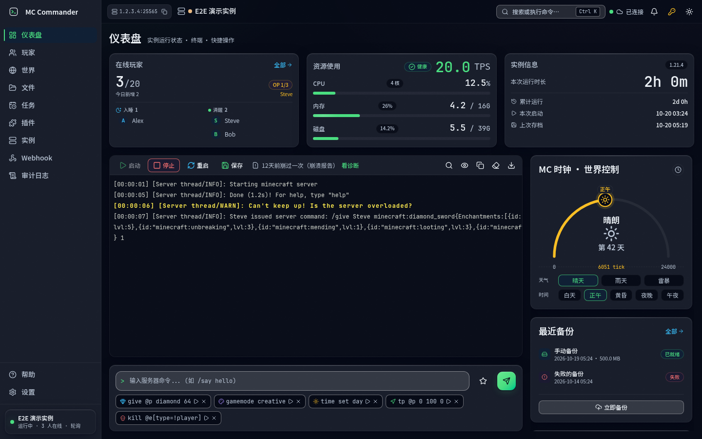
  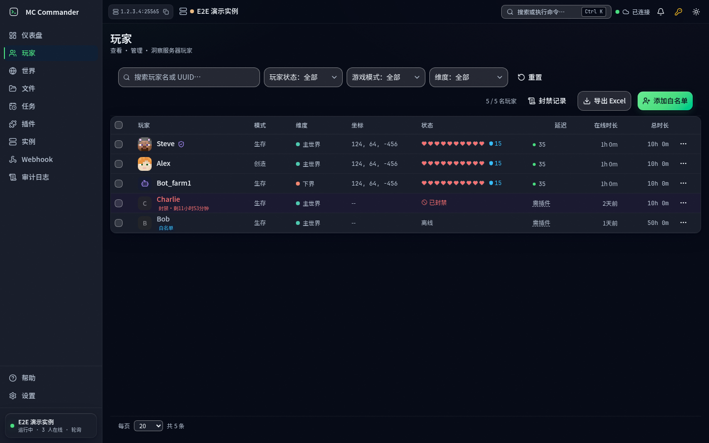
  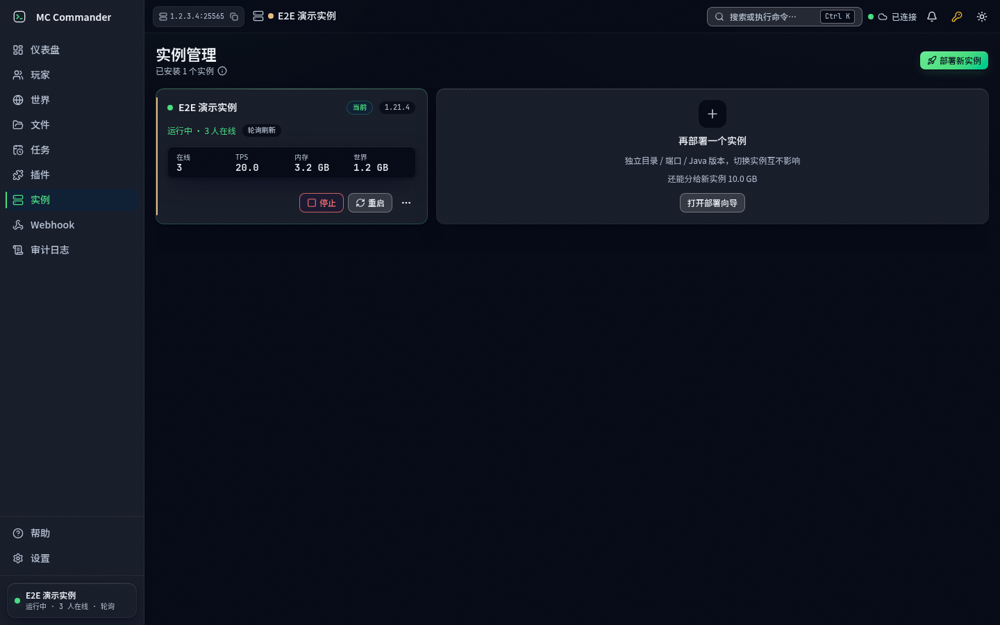
</p>

## 它适合谁 / 不适合谁
只做「服务器与玩家本身」的管理：原版做不到的操作（离线玩家背包写入、禁言）不做伪实现，插件生态里的玩法功能也不替代。

| 判断 | 说明 |
|---|---|
| **适合** | 一台到几台自己的 MC 服，想少敲命令的服主 |
| **适合** | 不想在服务端装插件、也不想进游戏的管理场景 |
| **不适合** | 要卖服务器 / 多租户分权 / 资源配额 |
| **不适合** | 要权限组、经济、领地这类玩法插件功能 |

## 快速开始

面向 Linux 服务器，Ubuntu / Debian 优先。Node.js 22+ 与 Java 17/21/25 由脚本自动安装，不用先准备。

1. **复制下面这一整行**（单行，不要拆开——拆开只会执行前半段，什么都不会发生），粘贴到服务器终端回车：

```bash
rm -f /tmp/deploy-mc-commander.sh && ( curl -fsSL --connect-timeout 10 --max-time 60 -o /tmp/deploy-mc-commander.sh https://gitee.com/wyyfzb/mc-commander/raw/main/apps/server/scripts/deploy-mc-commander.sh || curl -fsSL --connect-timeout 10 --max-time 60 -o /tmp/deploy-mc-commander.sh https://raw.githubusercontent.com/wyyfzb/mc-commander/main/apps/server/scripts/deploy-mc-commander.sh ) && sudo bash /tmp/deploy-mc-commander.sh
```

2. **等它跑完**：脚本会装系统依赖、下载代码、注册并启动系统服务，最后打印面板地址与一次性 `SETUP_TOKEN`。
3. **打开地址**：浏览器访问面板地址，按向导设置管理员密码，把 `SETUP_TOKEN` 粘进去（用后即作废）。

> **云服务器还需在控制台安全组放行 25566/TCP**——脚本只处理系统防火墙，云平台那一层它碰不到。打不开时按[常见问题](#常见问题)第一条排查。

装之前确认三件事：机器能访问外网（Gitee 或 GitHub 任一可达）、你有 `sudo` 权限、25566 端口没被别的程序占用。装完面板由 systemd 托管并随开机自启，用 `systemctl status mc-commander` 看状态。

脚本会把面板装到 `/opt/mc-commander`，创建专用低权限用户 `mc-commander` 并以它运行服务（25566 是高位端口，不需要 root）。

脚本默认走 Gitee 镜像，失败自动回退 GitHub，两源的代码包与校验摘要同源，下载带 sha256 校验；每处下载都有停滞中止与断点续传。最终仍失败时，按报错提示用 `VERSION=vX.Y.Z` 指定版本，或自行取包解压进安装目录后用 `SKIP_DOWNLOAD=1` 重跑。

一键脚本只面向 Linux；Windows / macOS 走[手动部署](#手动部署)。

装完下一步：[第一次使用](#第一次使用)——创建实例、启动，把地址发给玩家。

## 第一次使用

1. **进面板**：浏览器打开部署输出里的地址（形如 `http://<公网 IP>:25566`）。打不开先按[常见问题](#常见问题)第一条排查。
2. **设密**：首次进入是设置向导，设置管理员密码并确认，再把部署输出里的 `SETUP_TOKEN` 粘进去。设密成功后令牌立即作废，之后只用密码登录。
3. **创建实例**：侧栏「实例」→ 右上「部署新实例」，选服务端类型（Vanilla / Paper / Fabric / Forge / Purpur）、MC 版本、实例名称与内存，最后一步勾选 EULA 同意。
4. **启动**：勾了 EULA 的话部署完成后会自动启动；没勾就回实例列表点「启动」。首次启动要生成世界，等状态变成「运行中」。启动时若弹出 EULA 确认框，同意后面板会写入并重启。
5. **连服**：面板顶栏会显示这台实例的「地址:端口」，把它发给玩家在游戏里添加即可。端口在 25565–25664 之间由面板按实例分配，和面板自己的 25566 不是一回事。

> 玩家连不上时，先确认云安全组也放行了这台实例的游戏端口（默认从 25565 起），以及实例状态是「运行中」。

> 部署进度条会实时显示下载 / 安装 / 首启阶段；中途点「取消部署」会终止进程并清理未完成的实例目录，不会在列表里留下半个实例。

**改实例配置**：实例卡片 → 操作菜单 →「实例设置」，可改内存、Java 路径、JVM 参数，以及「实时推送」开关；这些改动都要重启实例才生效。

**先做一次备份**：进「设置 → 备份管理」点「立即备份」，之后改配置、升级版本或动存档前都多一个还原点。备份默认保留最近 10 份、30 天，可在服务端用环境变量调整。

**换个设备继续用**：手机或另一台电脑打开同一个面板地址，用同一管理员密码登录即可。忘了地址就进「设置 → 连接设置」，最下方「从其他设备访问」会显示当前地址，可一键复制。

**要给自动化工具用**：浏览器本身用不到 API Key；确实要接脚本时，在「设置 → 连接设置」里生成，明文只显示一次。

## 日常操作速查

| 想做什么 | 去哪里 |
|---|---|
| **玩家** | 侧栏「玩家」：给物品、传送、封禁、白名单、OP、踢出，命令全部由面板生成 |
| **世界** | 侧栏「世界」：server.properties 全表单 + 游戏规则，热改属性保存即生效 |
| **备份** | 设置 → 备份管理：立即备份、一键恢复、下载到本机做离机副本 |
| **文件** | 侧栏「文件」：浏览、编辑、上传、下载，编辑器里 Ctrl/⌘+S 保存 |
| **任务** | 侧栏「任务」：重启 / 备份 / 执行命令 / 停止 / 启动，cron 可视化编辑 |
| **通知** | 顶栏铃铛：未读徽章 + 抽屉，游戏事件、备份失败、资源告警都在这里 |

更细的操作步骤与逐页截图见[用户指南](docs/user-guide.md)。

## 界面一览

| 世界页：属性表单与游戏规则放在一起，热改保存即生效 | 文件页：浏览、上传、下载，内置编辑器改配置 |
|---|---|
| 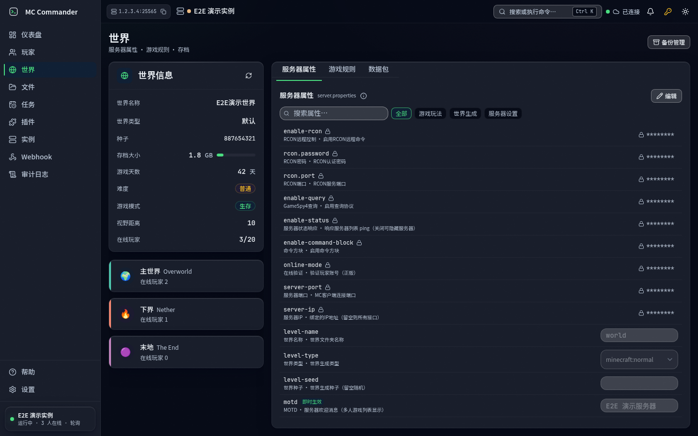 | 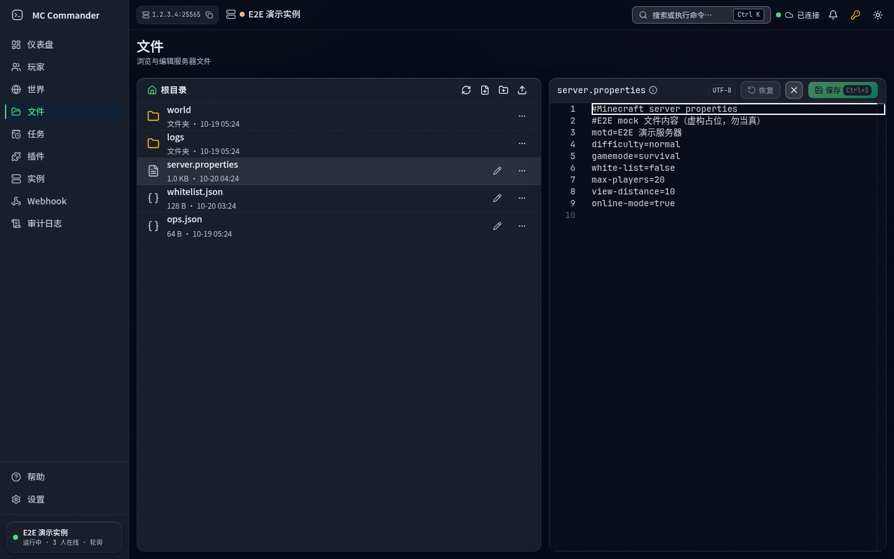 |

| 备份页：立即备份、一键恢复、下载做离机副本 | 任务页：五类任务用 cron 可视化编辑器编排 |
|---|---|
| 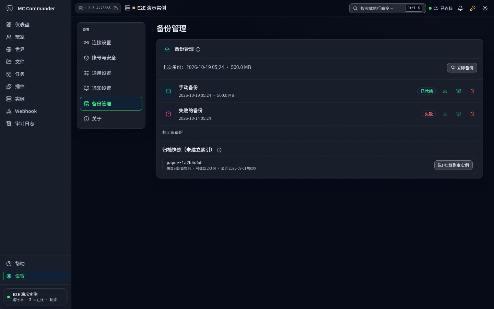 | 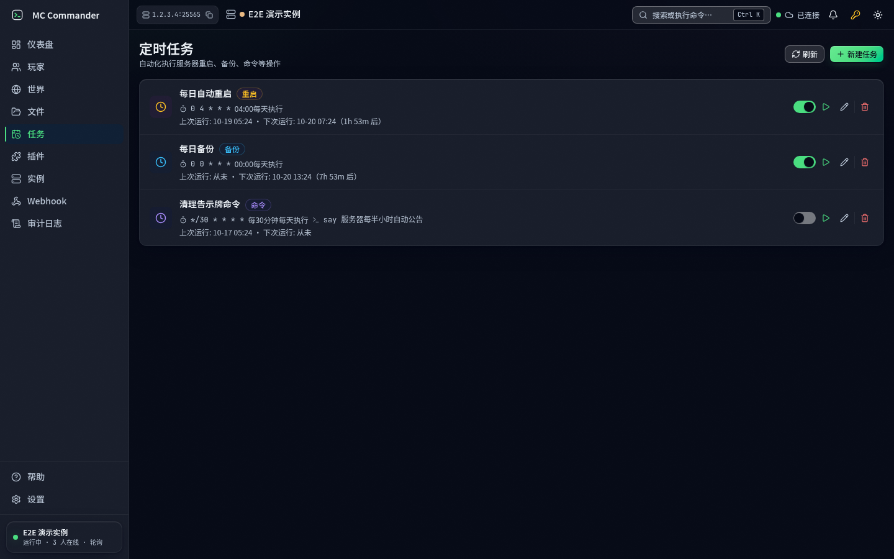 |

| 插件页：启停与上传，Modrinth 市场一键安装 | Webhook 页：飞书 / 钉钉 / 企微 / Server酱 / PushPlus |
|---|---|
| 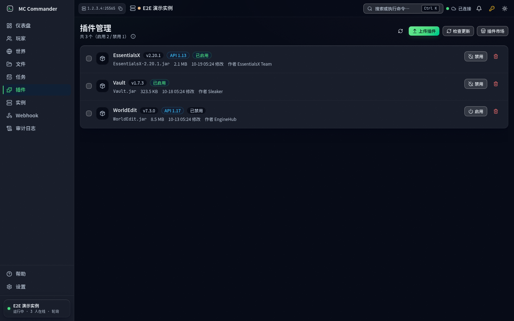 | 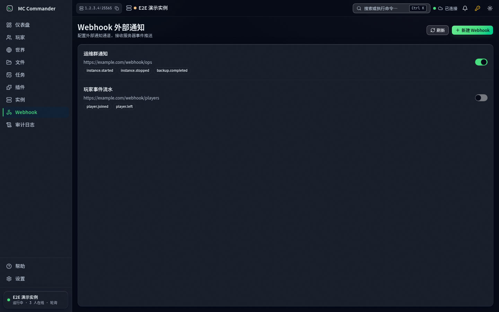 |

| 审计页：操作记录与命令历史双 Tab，可导出 Excel | 设置页：连接、账号与安全、通知、备份管理 |
|---|---|
| 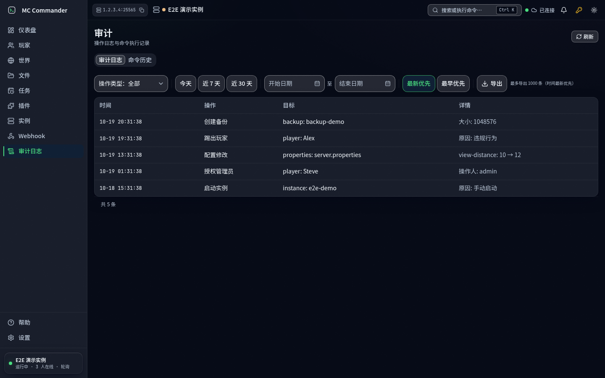 | 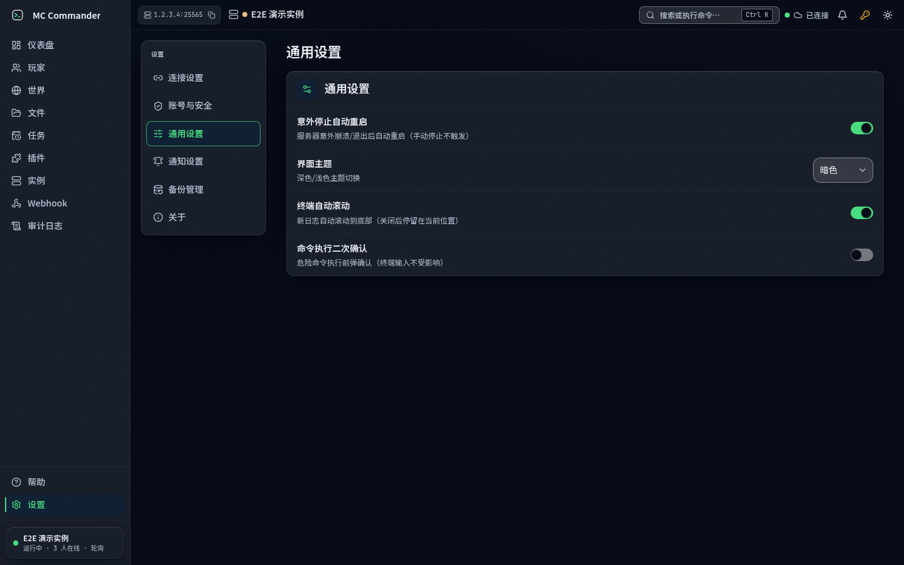 |

截图为示例环境（虚构数据），实际面板显示你的服务器真实状态。

## 升级 / 卸载 / 忘记密码

**升级**：重跑[快速开始](#快速开始)里的那条安装命令即可原地升级。脚本幂等，会保留 `.env`、`var/` 下的实例 / 数据库 / 备份，以及已装依赖，完成后自动重启服务。

**升级前**：面板自身数据每天自动快照到 `var/backups/panel/`；要额外留实例还原点，就去「设置 → 备份管理」点一次「立即备份」。

**升级后**：刷新面板页面确认版本号（设置 → 关于），再看一眼实例列表与备份列表是否完整；实例的世界存档不受升级影响。

**回滚**：`sudo VERSION=<旧版本标签> bash /tmp/deploy-mc-commander.sh` 只回退代码，`var/` 下的数据不回退。

**升级失败**：脚本在下载或校验阶段失败会中止并保留原版本，重跑同一条命令即可；已装好的服务不会停在半新半旧的状态。

**卸载**：`sudo bash /tmp/deploy-mc-commander.sh --uninstall` 移除面板但保留 `var/` 下的数据；连数据一起删用 `--uninstall --purge`（需二次确认）。脚本已不在 `/tmp` 时，先按快速开始第 1 步重新取一次。

卸载不会移除 25566 的防火墙放行规则（可能被其它服务共用），如不再需要请自行清理。

**忘记密码**：密码只存哈希、无法反解。清空管理员账号与会话后重启，面板即回到首访设密流程：

```bash
sudo systemctl stop mc-commander
sudo sqlite3 /opt/mc-commander/var/data/mc_commander.db "DELETE FROM admin_account; DELETE FROM admin_sessions;"
sudo systemctl start mc-commander
```

> 路径按默认安装目录 `/opt/mc-commander` 给出，装到别处请换成实际路径。只删这两张表，实例、备份、定时任务与审计记录都不受影响；会话必须一并清空——直接改库不经过改密接口，留着旧令牌仍能登录。机器上没有 `sqlite3` 时，用任意 SQLite 客户端执行同样两条语句即可。

## 常见问题

**面板地址打不开**
按顺序查三处：① 云服务器控制台 → 安全组，放行 `25566/TCP`；② 系统防火墙，`sudo ufw status` 看是否放行，没有就 `sudo ufw allow 25566/tcp`；③ 服务是否在跑，`systemctl status mc-commander`，日志用 `journalctl -u mc-commander -n 50`。

**实例一直起不来**
先看实例卡片与仪表盘上的崩溃提示、日志尾部；再确认 Java 版本（MC 26.x 需要 Java 25，旧版本用 17/21）、内存是否给够、端口是否被别的程序占用。

**面板提示需要开启 RCON**
`enable-rcon` 与 `rcon.password` 属安全敏感项，面板属性页只读。到服务器上编辑该实例的 `server.properties`，写入 `enable-rcon=true` 和自定义的 `rcon.password`，然后重启实例。

**备份失败**
先看通知与备份列表里的失败原因；再查磁盘剩余空间、Linux 是否装了 `rsync`、备份目录与实例目录是否在同一个文件系统上。

**数据不是实时刷新**
MC 1.21.9 及更新版本由面板在启动前自动开启实时推送，更旧的版本走 30 秒轮询。若在实例设置里关过「实时推送」，重新打开后重启实例生效。

**面板数据丢了 / 换机器**
面板自身每天快照到 `var/backups/panel/`：停服务 → 把目标快照复制为 `var/data/mc_commander.db` → 删掉 `-wal` / `-shm` 残留 → 启动。实例世界数据用实例备份恢复，两者相互独立。

## 进阶部署

### 加密访问（HTTPS）

面板在**同一个端口**上同时接受 HTTP 与 HTTPS，装好即可用，不需要额外端口、域名或反向代理。
证书由面板首次启动时自签（本地 CA，有效期 100 年），服务器换 IP 会自动重签而 CA 不变。

**在每台设备上导入一次根证书**，之后该设备访问面板就是全绿的 https（含手机装到主屏）：

1. 用 HTTP 打开面板并登录 → 「设置 → 账号与安全 → 传输加密」
2. 点「下载根证书」，按页面给出的分平台步骤安装
3. 回到该页点「检测」，确认显示已信任，再点「切换到 https」

浏览器不允许网页自行安装根证书，这一步必须由人操作一次。**根证书首次下载走 HTTP，可能与页面显示的 SHA-256 指纹核对**——指纹不一致就不要安装。

没导入根证书的设备继续走 HTTP，功能不受影响（面板从不把 HTTP 强制跳到 HTTPS：未受信时跳过去只会得到整页红色的证书警告）。

浏览器只在安全上下文（HTTPS 或 localhost）开放部分能力。用内网 / 公网 IP 走 HTTP 打开时实测：

| 能力 | HTTP 下 | 影响 |
| --- | --- | --- |
| 复制按钮 | 可用（降级 `execCommand`） | 无 |
| 装到手机主屏（PWA） | **不可用**（非安全上下文下浏览器不暴露 `navigator.serviceWorker`） | 手机端只能当普通网页用 |
| 登录密码与数据 | **明文过网** | 同网段可被嗅探 |

### 前置反向代理

已有域名与证书时，也可以照旧在前面终止 TLS。**`/ws` 必须单独声明 upgrade 头**，否则实时通道握手失败。

```nginx
server {
    listen 443 ssl;
    server_name mc.example.com;
    # ssl_certificate / ssl_certificate_key 指向你的证书
    location /ws {
        proxy_pass http://127.0.0.1:25566;
        proxy_http_version 1.1;
        proxy_set_header Upgrade $http_upgrade;
        proxy_set_header Connection "upgrade";
    }
    location / {
        proxy_pass http://127.0.0.1:25566;
        proxy_set_header Host $host;
    }
}
```

Caddy 两行就够：`mc.example.com { reverse_proxy 127.0.0.1:25566 }`（自动申请证书，WebSocket 开箱可用）。反代后按层数调 `TRUST_PROXY`。

### 手动部署

```bash
git clone https://github.com/wyyfzb/mc-commander.git && cd mc-commander
npm ci
npm run build -w apps/schemas && npm run build -w apps/web
mkdir -p apps/server/public && cp -r apps/web/dist/. apps/server/public/
cd apps/server && cp .env.example .env
# HOST 默认 127.0.0.1：远程浏览器打不开，必须在 .env 里改成 HOST=0.0.0.0
npm start
```

`API_KEY_HASH` 留空即可：首次启动会自己签发一把并写回 `.env`，明文只在启动横幅显示一次。云服务器同样要在控制台安全组放行 25566/TCP。

### Windows / macOS

实验性支持：官方脚本与发布包面向 Linux，需按上面的手动部署自行构建前端产物、没有服务托管（Windows 建议 WSL2）。macOS 自带 rsync 是 openrsync，硬链接去重未验证；`brew install rsync` 后用 `RSYNC_BIN` 指向 GNU rsync 可恢复增量快照。

### 环境变量

完整清单见 [`apps/server/.env.example`](apps/server/.env.example)。最常用的 5 个（默认值）：`HOST`=`127.0.0.1`（公网部署必须改 `0.0.0.0`）· `PORT`=`25566` · `SERVERS_DIR`=`./var/servers` · `DATA_DIR`=`./var/data` · `BACKUPS_DIR`=`./var/backups`（后三者相对路径锚定服务端安装目录）。

---

## 给贡献者

贡献流程与提交规范见 [docs/CONTRIBUTING.md](docs/CONTRIBUTING.md)，工程纪律与 CI 检查项见 [AGENTS.md](AGENTS.md)。开发只需 Node.js 22+（三个包都声明并强制 `engines`），Java 只在真正跑 MC 实例时需要。

### 提交与分支

- 从 `main` 拉功能分支（`feat/<主题>` / `fix/<主题>` / `docs/<主题>`），改动走 PR 回到 `main`。
- 提交信息用 Conventional Commits，描述用中文，scope 取 `web` / `server` / `schemas` / `ci` / `docs` 等。
- PR 必须 6 项检查全绿（格式与门禁、契约包、服务端、前端 lint/test、前端构建与 e2e、生产依赖审计），合并用 squash。

### 技术栈

| 层 | 技术 |
|---|---|
| 前端 | React 19 + TypeScript strict + Vite + Tailwind v4 + shadcn/ui |
| 状态 | TanStack Query + zustand |
| 服务端 | Node.js 22+ · Express · ws |
| 数据 | SQLite（better-sqlite3）+ zod 契约包 |
| 测试 | Vitest + Testing Library · Playwright e2e |
| 工程 | npm workspaces · Biome（格式化）· oxlint（lint） |

### 项目结构

```
mc-commander/
├── apps/web/       # 前端：React 19 + Vite
├── apps/server/    # 服务端：Express + ws + SQLite，同源托管前端产物
├── apps/schemas/   # 共享契约包（zod）：src/ + tests/；dist/ 是构建产物、不入库
├── tools/          # 维护者工具：gates/ · e2e/ · ci/ · dev/ · ops/ · deploy/
├── docs/           # 用户指南、架构、贡献与安全文档、截图
└── AGENTS.md       # 工程纪律与提交规范
```

### 开发与测试

```bash
npm ci                         # 仓库根一次装齐三个包
npm run build -w apps/schemas  # 服务端消费契约包产物，先构建
npm test -w apps/server        # 服务端用例
npm run dev -w apps/web        # 前端开发服务器（5173，代理到 25566）
npm run test -w apps/web       # 前端单测
npm run test:e2e               # Playwright e2e
bash tools/ci/local-check.sh   # 一键本地检查（格式 + lint + 类型 + 全量测试）
```

本地检查脚本支持 `--skip-frontend` 与 `--skip-schemas`，只改一个包时能省掉无关步骤；它和 CI 跑的是同一套检查，本地全绿基本就能过。测试与文档中一律使用虚构数据（`1.2.3.4`、TEST-NET 网段、Steve/Alex），禁止出现真实服务器 IP、API Key 与玩家数据。

架构与设计决策见 [docs/architecture.md](docs/architecture.md)，API 与事件清单见 [apps/server/README.md](apps/server/README.md)，CI 工作流见 [`.github/workflows/ci.yml`](.github/workflows/ci.yml)。

## License

[AGPL-3.0](LICENSE)（GNU Affero General Public License v3.0）。修改版通过网络提供服务时，同样需要以 AGPL-3.0 开源你的修改。

## 参与贡献

- 贡献流程与开发环境：[docs/CONTRIBUTING.md](docs/CONTRIBUTING.md)
- 安全问题报告：[docs/SECURITY.md](docs/SECURITY.md)
- 行为准则：[docs/CODE_OF_CONDUCT.md](docs/CODE_OF_CONDUCT.md)
